# Next-phase engineering roadmap

**Status date:** 22 November 2026  
**Current checkpoint:** Commits 39-45 merged; post-release scorecard integrity fix PR #18 merged.

This roadmap separates verified capabilities from the next engineering work. The project remains a local-first, open-source toolkit. No hosted leaderboard, paid API, central scoring service, or third-party Python runtime dependency is required.

## Current baseline

- Declarative challenge-pack loader and evaluator for ten synthetic domains.
- Six executable adversarial suites, including persistent JSONL sessions.
- Interactive `tool-loop-v1` with deterministic mock tools and runtime permission checks.
- POSIX resource hardening with process-group cleanup, bounded I/O, and fail-closed strict namespace mode.
- Canonical evidence provenance and OpenSSH signatures.
- Signature-bound public scorecard claims, including suite summaries, seed inventories, GRI, evidence references, and provenance metadata.
- Coverage-aware ten-domain GRI and registered-signer admission gate.
- Deterministic 25-seed synthetic calibration baseline.
- Python 3.11, 3.12, and 3.13 CI matrix.

The baseline is a calibrated prototype, not a measurement of external commercial models. Signatures authenticate signed claims by a key holder; they do not establish truth or independent execution.

## Priority order

### P0. Portable evidence archive and offline submission verifier

**Why first:** The current gate validates the signature and internal consistency of a scorecard. It does not fetch, unpack, and independently replay every evidence bundle referenced by an external submission. This is the largest remaining gap between a signed claim and independently verifiable evidence.

**Proposed deliverables**
1. A deterministic, portable submission archive containing:
   - `submission-manifest.json`
   - `scorecard.json` and detached `scorecard.json.sig`
   - all six adversarial evidence bundles
   - all ten challenge-pack snapshots and pack-result files
   - a canonical path/hash inventory
2. `agent-gauntlet export-submission` to assemble the archive offline.
3. `agent-gauntlet verify-submission` to verify the signature, path/hash inventory, challenge-pack identities, evidence bundles, suite summaries, case counts, seed inventories, pack assertions, and GRI.
4. A bounded, safe archive reader that rejects path traversal, symlinks, duplicate paths, oversized members, decompression bombs, and unexpected files.
5. A verification report that distinguishes:
   - signature valid
   - archive integrity valid
   - evidence bundles locally verified
   - challenge results independently recomputed
   - independent external reproduction

**Acceptance criteria**
- A clean clone can verify a submission without network access.
- Altering any evidence file, scorecard claim, challenge pack, seed list, or pack result is detected.
- The verifier recomputes suite metrics from raw results rather than trusting scorecard summaries.
- Archive extraction is never performed directly into an arbitrary user directory.
- Tests cover malformed ZIP metadata, path traversal, duplicate names, oversized content, symlinks, and tampered evidence.

### P1. Independent reproduction harness

**Purpose:** Allow a second operator to rerun a declared agent and challenge revision using the same seeds and compare the result to a submitted archive.

**Proposed design**
- Freeze the challenge-pack commit and adapter version in a reproduction manifest.
- Re-run the exact seed inventory through the explicit adapter protocol.
- Compare per-case canonical outputs and evaluator results.
- Report exact matches, deterministic mismatches, environment differences, and non-reproducible cases separately.
- Never silently replace the original evidence with a reproduction.

**Acceptance criteria**
- Reproduction produces a new evidence bundle linked to the original submission.
- The report records the operator, source commit, Python version, platform, adapter command identity, and seed inventory.
- Reproduction status is separate from signature validity and local archive verification.

### P2. Containment and protocol conformance

**Purpose:** Make process boundaries consistent and accurately reported across single-turn, JSONL-session, and interactive tool-loop adapters.

**Proposed design**
- Consolidate process-group lifecycle, timeout handling, bounded stdout/stderr, and resource-limit reporting behind shared primitives.
- Add explicit conformance tests for Linux namespace availability, resource-limit application, process-tree cleanup, partial frames, oversized frames, and abrupt child exit.
- Test Linux and macOS POSIX behavior. On Windows, report unsupported POSIX containment clearly rather than silently emulating it.
- Keep strict namespace isolation opt-in and fail closed when unavailable.
- Preserve the explicit warning that these controls are not a filesystem sandbox. Hostile adapters still require a dedicated VM or externally enforced sandbox.

**Acceptance criteria**
- All adapter modes report their effective controls, not merely requested controls.
- No test or documentation describes resource limits or namespaces as filesystem isolation.
- Process descendants are cleaned up on timeout and protocol failure.
- Output capture remains bounded under concurrent stdout and stderr floods.

### P3. Challenge quality and version governance

**Purpose:** Prevent challenge drift and make benchmark changes reviewable.

**Proposed design**
- Version challenge packs independently from the CLI.
- Add a pack validation command that checks schema, fixture identity, permissions, assertions, expected outputs, and deterministic seeds.
- Require challenge authors to provide a threat model, scoring rationale, known blind spots, and at least one negative-control fixture.
- Freeze challenge versions and scoring code for each benchmark window.
- Publish challenge-pack digests before accepting a benchmark cohort.
- Add mutation tests to prove each assertion can fail for the intended reason.

**Acceptance criteria**
- A challenge pack cannot enter the catalog without passing structural and behavioral validation.
- Version changes produce explicit diffs and new provenance hashes.
- Human review is required for scoring changes that alter rankings.

### P4. Signer governance and transparency

**Purpose:** Keep the federated model decentralized without allowing silent trust changes.

**Proposed design**
- Document evaluator registration, signer key creation, allowed-signers configuration, rotation, revocation, and incident response.
- Record trust-registry changes with reviewer, timestamp, prior digest, and new digest.
- Add an optional append-only local transparency log using a hash chain and signed checkpoints.
- Keep each operator's registry independent. No central authority is required.
- Provide a public submission template that makes the evidence level explicit.

**Acceptance criteria**
- A key can be revoked without rewriting historical submissions.
- Registry changes are auditable.
- A verifier can validate a log from its initial checkpoint without network access.
- Signer custody, evidence integrity, local replay, and independent reproduction remain distinct statuses.

### P5. Comparative leaderboard readiness

**Do not begin global ranking yet.** The current signer registry is empty and there are no external submissions in the repository. The green leaderboard workflow currently proves that the empty bootstrap board is structurally valid, not that any external agent has been admitted.

Before public comparisons:
- collect multiple independent evaluator submissions;
- require complete suite and domain coverage;
- verify portable evidence archives;
- reproduce a sample independently;
- publish per-domain results and limitations;
- define dispute, withdrawal, and challenge-version policies;
- report sample sizes and uncertainty rather than presenting one composite score as an absolute truth.

## Proposed architecture

The target is an offline-verifiable evidence pipeline. The verifier is a local command, not a hosted service.

```mermaid
flowchart LR
    A[Agent adapter] --> B[Process controls]
    B --> C[Runtime tool permission gate]
    C --> D[Challenge evaluator]
    D --> E[Raw results and evidence bundles]
    E --> F[Portable submission archive]
    F --> G[OpenSSH signature and provenance]
    G --> H[Offline submission verifier]
    H --> I[Local federated admission gate]
    I --> J[Independent reproduction status]
```

The order is intentional: preserve raw results first, package them second, sign the complete claims and provenance third, and independently reproduce after verification. A signature must never be treated as a substitute for evidence.

## Release gates

| Gate | Required evidence | Release posture |
|---|---|---|
| Prototype baseline | Current CI matrix and 25-seed synthetic controls | Complete |
| Signed scorecard integrity | Claims digest covered by OpenSSH payload and tamper tests | Complete in PR #18 |
| Portable evidence verification | Offline archive verifier and tamper matrix | Next priority |
| Independent reproduction | Separate operator reruns fixed seeds | Pending |
| Federated comparison | Multiple independently reproduced external submissions | Not ready |

## Immediate next engineering task

Implement **P0: Portable Evidence Archive and Offline Submission Verifier** as a separately reviewable feature branch. Keep the current scorecard and attestation formats backward-compatible only if the new archive format explicitly marks legacy submissions as non-replayable. Do not grant leaderboard admission at the independent-reproduction evidence level until the verifier can inspect and recompute the actual archived artifacts.
